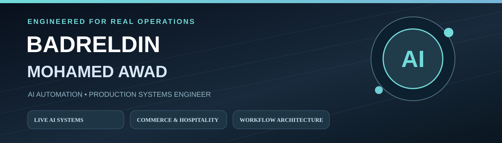

### AI Automation & Production Systems Engineer | n8n, Applied AI, APIs & Business Integrations

**I turn complex business processes into operating AI systems — with real integrations, state management, human oversight and measurable execution.**

---

## Featured production platform

### [TACTIC × AMER — AI Media Production Platform](https://github.com/Badrna3om/tactic-ai-media-platform) · **Live, multi-service operation**

A production AI platform I designed and operate. It monitors sports events and news, evaluates content relevance, generates multiple branded media formats, coordinates reviews and corrections, and handles publishing or video delivery through separate tracked pipelines.

Animated preview of six actual, published TACTIC graphic formats — not a simulated live dashboard.

| **3,091** | **837** | **3,517** |
| :--: | :--: | :--: |
| Rendered content jobs | Records marked published | Indexed source videos |

*Production database snapshot: **23 November 2026**. These are tracked operational records, not audience views or distinct Snapchat posts.*

**Business capability:** end-to-end AI operations, editorial intelligence, reliable work queues, branded media production, human approval, asset management, monitoring and recovery.

**Tech:** n8n · Supabase/PostgreSQL · LLM APIs · JavaScript · REST/webhooks · Telegram · media rendering services.

**[Explore flagship case study →](https://github.com/Badrna3om/tactic-ai-media-platform)** | [60-second video tour](https://github.com/Badrna3om/tactic-ai-media-platform/blob/main/assets/tactic-showreel.mp4) | [90-second recruiter tour](https://github.com/Badrna3om/tactic-ai-media-platform/blob/main/docs/RECRUITER_TOUR.md) | [Published TACTIC work](https://x.com/TacticSpoort) | [AMER on Snapchat](https://www.snapchat.com/@amer.aaa)

---

## Other systems I've built

<table>
<tr>
<td width="50%" valign="top">
<h3><a href="https://github.com/Badrna3om/buaskoor-ai-commerce-platform">AI Commerce · BUASKOOR</a></h3>
<strong>Conversational commerce &amp; WooCommerce operations</strong>

Arabic AI sales assistance, product discovery, persistent cart context, order validation, customer handover and commerce notifications.

<small>n8n · WhatsApp · WooCommerce · JavaScript · REST APIs</small> 
<a href="https://github.com/Badrna3om/buaskoor-ai-commerce-platform">View the sanitized public portfolio →</a>
</td>
<td width="50%" valign="top">
<h3><a href="https://github.com/Badrna3om/ai-restaurant-operating-system">Restaurant AI Operating System</a></h3>
<strong>AI-assisted guest-to-kitchen workflow</strong>

Conversational ordering, customer sessions, kitchen and waiter handoff, billing status, dashboards and operational reporting.

<small>n8n · WhatsApp · Supabase · JavaScript · AI models</small> 
<a href="https://github.com/Badrna3om/ai-restaurant-operating-system">Explore the public implementation →</a>
</td>
</tr>
<tr>
<td width="50%" valign="top">
<h3><a href="https://github.com/Badrna3om/ai-content-automation-for-e-commerce">E-commerce Content Automation</a></h3>
<strong>Arabic SEO &amp; marketing production</strong>

Content planning, product enrichment, AI writing, WordPress draft creation, social copy and editorial notifications.

<small>n8n · OpenAI · WordPress · WooCommerce · Google Sheets</small> 
<a href="https://github.com/Badrna3om/ai-content-automation-for-e-commerce">View the workflow case study →</a>
</td>
<td width="50%" valign="top">
<h3><a href="https://github.com/Badrna3om/ai-football-intelligence-engine">AI Football Intelligence Engine</a></h3>
<strong>Verified-data reasoning prototype</strong>

Fixture resolution, structured sports analysis, player identity matching, evidence checks and multi-format structured output.

<small>n8n · API-Football · OpenAI · JavaScript</small> 
<a href="https://github.com/Badrna3om/ai-football-intelligence-engine">Explore the standalone prototype →</a>
</td>
</tr>
</table>

*The public repositories contain selected source examples, sanitized workflow exports, or case studies. They are **not** complete copies of the related private operating systems. Project status is described in each repository.*

## My engineering approach

| What teams need | What I engineer |
| :-- | :-- |
| Fewer disconnected steps | End-to-end API and workflow integration |
| Predictable AI behavior | Guardrails, structured outputs and business rules |
| Human accountability | Approval gates, escalation and audit trails |
| Operational resilience | Idempotency, retries, monitoring and failure handling |
| Scale beyond a proof of concept | Persistent state, modular services and production pipelines |

## Technology toolkit

**AI & automation:** n8n · LLM agents · OpenAI-compatible APIs · prompt/workflow orchestration

**Backend & data:** Supabase · PostgreSQL · REST APIs · Webhooks · JavaScript · JSON

**Business integrations:** WooCommerce · WordPress · WhatsApp APIs · Telegram · Google Workspace

**Delivery & operations:** Docker-based services · state machines · operational dashboards · human-in-the-loop review

**Background:** Electronics Engineering, with postgraduate study in Networking and Communications.

---

### Looking for an AI Automation / Integration Engineer?

I can discuss how these production patterns translate into customer operations, commerce, hospitality, media and internal business workflows.

**[Get in touch](mailto:badrna3om@gmail.com)** · **[Explore my flagship system](https://github.com/Badrna3om/tactic-ai-media-platform)**

